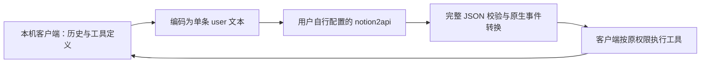

# 把文字桥接接到其他本地 agent

本文归纳独立 DSH 仓库与本仓库的 Hermes 实现，供 agent 或开发者适配 OpenCode、pi 等客户端。**OpenCode 和 pi 尚无本仓库可直接安装的实现，也未完成实机验收。** 先与用户确认要适配其电脑上的哪个客户端、版本、profile 与目录，再开始修改。

## 为什么只有地址和 key 可能不够

本仓库针对的一类 notion2api 文字桥接会丢失其他角色或原生工具字段。因此“能聊天”和“能让客户端执行工具”是两件需要分别验证的事。若用户自己的接口已经完整支持该客户端要求的工具协议，优先直接接入，不要机械增加此桥接。

适配器负责把模型的工具决策交回客户端。它不自行读文件、执行 shell 或模拟成功结果。



请求地址与凭据由使用者在本机私密输入。这里不提供可用服务器地址或共享凭据。

## 可复用的协议

保留 system/developer 指令、完整必要历史、工具定义、每个 call ID，以及对应真实工具结果。将它们合入一个结构化文本请求，明确“路径属于当前客户端电脑；模型通过客户端请求工具；不得使用 Notion 原生页面工具”。

模型下一步只能返回一种完整 JSON：

```json
{"tool_calls":[{"name":"本轮声明的工具名","arguments":{"参数":"值"}}]}
```

或无后续工具的最终回答：

```json
{"text":"最终回答"}
```

处理规则：

1. 不从普通散文中截取 JSON；不允许同时返回最终文本与工具调用。当前参考实现允许包裹完整对象的单层 JSON 代码围栏。
2. 工具名必须在本轮可用列表内，参数必须是 JSON 对象并由客户端按 schema 校验；保留客户端的权限、审批与工作目录约束。遵守 `tool_choice`，不执行未声明操作。
3. 为工具调用生成唯一 ID，以同一 ID 接回真实结果；依赖前一步结果的调用应分轮完成。文件内容中的示例 JSON 不能自动变成工具执行。
4. 按目标客户端转换调用、增量、块结束与完成原因。上游先整体返回、再合成流事件时，要如实说明不是逐 token 上游流。
5. 注册模型只暴露实际支持的能力。当前代码提供 Sonnet 5.5 / Opus 5.5 文本与工具能力；其他模型即使出现在远端目录，也需另行验证。

DSH 代码见 [`adapter.mjs`](https://github.com/5483666/dsh-notion-local-tools/blob/main/adapter.mjs) 的 `encodeRequest` / `decodeReply`；Hermes 代码见 [`notion_bridge.py`](../hermes/notion_bridge.py) 的 `encode_request` / `decode_reply`。两者采用相同思路，但宿主的配置、消息与事件格式各自独立；不能直接把一个客户端的插件目录装给另一个。

## 选择目标客户端入口

| 目标 | 优先检查的扩展入口 | 需要补的转换 |
| --- | --- | --- |
| DSH | 已有 `Config`、凭据服务与 LLM adapter | DSH block/tool-call/finish 事件 |
| Hermes | 已有 `ProviderProfile.create_client()` | OpenAI SDK 同步、SSE 与异步辅助路径 |
| OpenCode | 当前版本的 provider/SDK 与插件接口 | 该版本所用 SDK 的模型请求及原生工具流 |
| pi | 当前版本 provider extension 的 `stream` / `streamSimple` | 该版本 transcript、工具块与终止事件 |
| 其他 | 官方模型提供商、transport 或 middleware 扩展契约 | 本机客户端的真实请求/结果循环 |

这些是适配起点，不是可直接使用的 OpenCode/pi 插件。检查本机已安装类型定义和官方示例，确认能覆盖请求、响应、工具历史及流式结束；仅能修改提示词或在工具执行前后监听的 hook，不一定能承担完整模型协议转换。

OpenCode 参考[官方插件文档](https://opencode.ai/docs/plugins/)与[提供商文档](https://opencode.ai/docs/providers/)。先验证当前接口是否能拦截完整模型请求与回复；无法覆盖时，再与用户明确是否采用仅监听本机回环地址的兼容服务。不要把只有 baseURL/model 配置的方案当作已实现工具转换。

pi 参考[官方 Custom Providers](https://github.com/earendil-works/pi/blob/main/packages/coding-agent/docs/custom-provider.md)。当前文档包含 `pi.registerProvider()` 和自定义 stream 契约；本机版本可能仍使用旧包名或不同 transcript 结构。以该版本源码为准，检查系统指令与工具声明的来源，成对生成内容事件并且只产生一次终止事件，保留取消与请求观察接口。不能把本文当作固定版本的完整实现。

## 实现顺序

1. **确认目标。** 让用户明确客户端和修改范围；不要根据 agent 自身名称或仓库名称猜测。只处理用户选定客户端。
2. **隔离验证。** 新建空白测试 profile/目录，不复制历史、消息渠道或业务任务；检查默认模型、辅助模型和 backend 是否会继承或自动启动。
3. **实现边界。** 先验证文字、一次工具调用和带真实结果的下一轮，再接入该客户端的流式、错误分类与取消。优先原生插件，避免修改客户端核心。
4. **检查所有请求路径。** 除主聊天外，标题、压缩、辅助异步请求、重试及新建 SDK client 都不能绕过桥接。凭据按用户选择的 profile 隔离；一次调用的配置快照应前后一致。
5. **运行真实文件任务。** 在下节条件满足后，才将新增提供商接入用户确认的常用配置；不替换默认模型或其他连接。
6. **交付与回滚。** 说明入口、版本、已验证的模型/系统、仍未知的部分和撤销方式；备份与私人验收留在用户本机。

## 错误与配置的易错处

- 有些宿主捕获插件构造异常后会回退普通 SDK。参考 Hermes 的本地拒绝方式，保证非法地址或缺失连接信息不会触发未经适配的外发。
- 收到 HTTP 头以后，读取正文仍可能超时、取消或断开；应保留 transport 分类，不能一律当作 JSON 格式错误。
- 宿主可能在同步转异步、修改超时或更新凭据时重新构造客户端。要在这些实际路径验证，而不是仅测试一次 `.create()`。
- 按宿主契约管理异步资源与所属事件循环，不强制在另一个仍活动的 loop 中关闭共享客户端。
- 不降低 TLS、权限或插件隔离保护来让安装通过。参考代码不适用时明确报告，再讨论替代方案。
- 不回显任意上游错误正文、Authorization、请求体或真实连接地址。用量/费用字段缺失时如实标明未知。

## 独立文件验收

由测试控制端生成随机 `input.txt`，随机内容不放入模型任务提示词。让模型只通过目标客户端的文件工具执行：

```text
读取 input.txt → 把读到的内容写入新的 output.txt → 回读 output.txt
```

明确末尾换行要求，模型不用 shell 或额外文件。控制端独立比较实际文件字节，查看工具名称、call/result 对应关系、实际模型路由和终止状态。分别报告“插件可见”“模拟/单元测试”“真实工具调用”“磁盘字节核对”，不要相互替代。没拿到用户自己的连接信息时，停留在模拟/本地协议验证并说明限制，不能索取仓库作者的地址或密钥。

需要覆盖的边界包括未声明工具、散文夹杂 JSON、非文本输入、错误正文脱敏、正文读取超时、取消、配置变化以及目标客户端的异步路径。仓库中的夹具均为虚构内容；私人验收输出不属于公开代码。

## 分享前检查

只提交明确允许的源码、说明和虚构测试夹具。排除 `.env`、认证文件、私人服务的实际 IP/域名/请求 URL、实际 key/cookie、用户 profile 名称、会话、截图、验收输出、备份与日志。检查待提交差异、所有公开 Git 引用的历史、Release 正文及解压后的附件；仅删除当前文件不能消除已经提交的泄漏。若发现泄漏，立即通知所有者并先处理凭据和历史，不要继续发布含敏感内容的包。

本仓库为 MIT License，可按上述方法在自己的机器或分支继续适配；不要把未验收客户端标成“开箱即用”。
